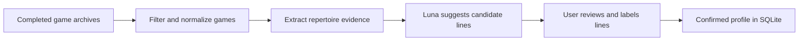
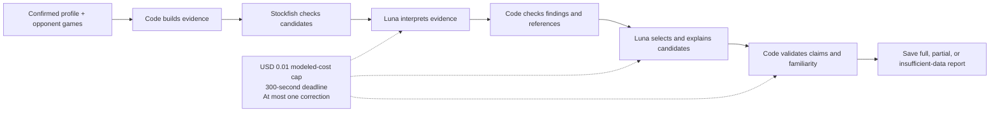
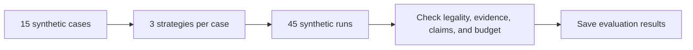
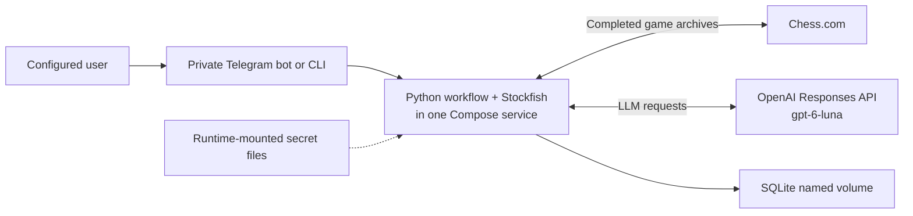

# Chess Agents

Private chess preparation from completed Chess.com games, available through a CLI and a Telegram bot.

## Workflow

The project combines deterministic data and chess analysis with constrained LLM work, explicit validation, offline evaluation, and a private container deployment.

### 1. Build a reviewed profile



### 2. Generate a bounded prep report



### 3. Evaluate the workflow offline



### 4. Run privately



Recorded evidence includes 68 passing offline tests, 45 synthetic evaluation runs, and a verified Linux/arm64 container build. These checks demonstrate contracts and deployment behavior; they do not establish live model quality, Chess.com coverage, Telegram delivery, or usefulness to players.

## Run with Docker Compose

Requirements: Docker with Compose, an OpenAI API key, a Telegram bot token, and a Telegram numeric user ID. The Mac or server running Docker must stay awake and connected. The verified image is Linux/arm64 only so far.

1. Create a bot with [Telegram's BotFather](https://core.telegram.org/bots/features#creating-a-new-bot): send `/newbot` and copy its token. To find your Telegram user ID, open [@userinfobot](https://t.me/userinfobot) and tap **Start**; copy the numeric ID it returns, not your `@username`. This is a third-party lookup bot, so never give it your bot token, login code, or password. Telegram documents the numeric field as [`User.id`](https://core.telegram.org/bots/api#user). The app accepts commands only from this ID in a private chat.
2. Create the local configuration and secret files. Paste each credential into its own file using a local editor; do not commit them:

   ```sh
   cp .env.example .env
   mkdir -p .secrets
   touch .secrets/openai_key .secrets/telegram_token
   chmod 700 .secrets
   chmod 600 .secrets/openai_key .secrets/telegram_token
   ```

   Put the OpenAI key in `.secrets/openai_key` and the BotFather token in `.secrets/telegram_token`. Edit `.env` and set these values:

   ```dotenv
   TELEGRAM_ALLOWED_USER_ID=123456789
   CHESS_USER_AGENT="chess-agents/0.1 (contact: you@example.com)"
   ```

   Replace the sample ID with your numeric Telegram ID from step 1 (digits only), and replace the sample email with an address you monitor. `CHESS_USER_AGENT` is a label sent with this app's requests to Chess.com; you choose it, and it is not a key. Chess.com recommends including a client name/version and contact details in its [PubAPI guide](https://support.chess.com/en/articles/9650547-what-is-the-pubapi-and-how-do-i-use-it).

   Compose mounts the credential files at `/run/secrets/openai_key` and `/run/secrets/telegram_token`. `.env` is ignored by Git; the example contains no credentials. Mode `0600` files were verified readable by UID 10001 with Compose on OrbStack. On native Linux, set the mounted files' owner to UID 10001 with mode `0600`, or group to GID 10001 with mode `0640` and keep `.secrets` private; then verify with `doctor`. Do not make secret files world-readable.
3. Start the service:

   ```sh
   docker compose up --build -d
   ```

   The container runs as UID 10001. SQLite lives at `/data/chess-agents.sqlite3` in the `chess-data` named volume. Check local SQLite and Stockfish startup without paid calls using `docker compose run --rm chess-agents chess-agents doctor`.
4. Open your bot's private chat and follow [Use with Telegram](#use-with-telegram) below to build your profile and request prep.
5. Stop the service with `docker compose down`. This preserves `chess-data`; `docker compose down -v` deletes the database and saved profiles/reports.

Check container status and watch logs live:

```sh
docker compose ps
docker compose logs --tail=100 -f chess-agents
```

Press **Ctrl+C** to stop watching; the bot keeps running. Logs can be empty because the bot has no startup or successful-request messages. Send `/start` in Telegram to check that it replies; container health checks cover SQLite and Stockfish.

The bot accepts commands only from the configured user in a private chat. It processes completed standard games for preparation before a game. It rejects live-game, board, FEN, and screenshot requests. Sparse evidence, unavailable services, or exhausted limits can produce a partial or insufficient-data result. Saved results remain available through `/last` after a restart. Bot setup and fake-update behavior are implemented, but no real token, bot initialization, or Telegram delivery was tested.

## Use with Telegram

Start the service with the [Docker Compose setup](#run-with-docker-compose) above. Use the Telegram account matching `TELEGRAM_ALLOWED_USER_ID` and open a private chat with your own bot. Replace the username placeholders below with Chess.com usernames; send each command as a separate message.

1. Send `/start` or `/help` to see the available commands.
2. Build a draft from your completed games:

   ```text
   /setup <my_username>
   ```

3. The bot shows candidate lines with review buttons. Choose **Familiar** for lines you know, **Learning** for lines you are learning, or **Exclude** for lines you do not want recommended. Review at least one line, then tap **Confirm profile**. A familiar main-line recommendation requires a line marked Familiar. Send `/profile` to reopen the review.
4. Before a game, request prep for your opponent and **your** color:

   ```text
   /prep <opponent_username> white
   ```

   Use `black` instead of `white` when you will play Black. The bot acknowledges the request, then attempts to replace that message with the saved report. Sparse evidence or exhausted limits can produce a partial or insufficient-data result.
5. Retrieve the latest saved report without another model call:

   ```text
   /last
   ```

Your confirmed profile and saved report survive container restarts. Run `/setup <my_username>` again to rebuild your repertoire from newer games; your previous confirmed profile remains usable until you confirm the replacement.

## Use with the CLI

Install Python 3.12, uv, and Stockfish. Run commands from the repository root. CLI preparation needs an OpenAI key and `CHESS_USER_AGENT`; Telegram credentials are needed only when starting the bot.

Runtime secrets can be supplied as `OPENAI_API_KEY` and `TELEGRAM_BOT_TOKEN`, or as `OPENAI_API_KEY_FILE` and `TELEGRAM_BOT_TOKEN_FILE`. The example below uses the private `.secrets/openai_key` file created in [setup step 2](#run-with-docker-compose). Create that file with your key first if you have not already done so. The CLI does not automatically load `.env`.

1. Install dependencies and configure the local database, Stockfish executable, and credentials. Replace the Stockfish path and contact email with your own values:

   ```sh
   uv sync
   mkdir -p .local
   export CHESS_DB="$PWD/.local/chess-agents.sqlite3"
   export STOCKFISH_PATH="/path/to/your/stockfish"
   export CHESS_USER_AGENT="chess-agents/0.1 (contact: you@example.com)"
   export OPENAI_API_KEY_FILE="$PWD/.secrets/openai_key"
   uv run chess-agents doctor
   ```

   `doctor` checks SQLite and Stockfish without paid calls. These database and executable settings replace the container defaults, which are not suitable for most host installs.

2. Build and inspect your profile. Replace `<my_username>` with your Chess.com username:

   ```sh
   uv run chess-agents profile build <my_username>
   uv run chess-agents profile show
   ```

3. Copy a line's `id` from the profile JSON, then review it. Replace `<line_id>` with that line's ID, not the profile's ID:

   ```sh
   uv run chess-agents profile set-line <line_id> familiar
   ```

   Use `familiar`, `learning`, or `exclude` for each line you review (see [Profile labels](#profile-labels)). Review at least one line before confirming; a familiar main-line recommendation needs a line marked `familiar`.

   ```sh
   uv run chess-agents profile confirm
   ```

4. Generate prep using your opponent's Chess.com username and your color:

   ```sh
   uv run chess-agents prep <opponent_username> white
   ```

   Use `black` when you will play Black. The report is printed to the terminal and saved in SQLite, including partial or insufficient-data results.

5. Retrieve the saved report without another model call:

   ```sh
   uv run chess-agents last
   ```

Profile review and confirmation do not make model calls; each profile build has its own cost limit. Use `uv run chess-agents --help` for all commands. To run the Telegram bot natively, also set `TELEGRAM_BOT_TOKEN_FILE` and `TELEGRAM_ALLOWED_USER_ID`, then run `uv run chess-agents bot` and leave it running.

`uv run chess-agents evaluate evals/cases.json` runs offline evaluation. Adding `--live` makes paid requests and prints the case count and maximum total charge before starting.

## Profile labels

Your games show which opening lines you have played; reviewing them tells the app which ones you actually know.

| Label | When to choose it | Effect on preparation |
| --- | --- | --- |
| **Familiar** (`familiar`) | You know the line and feel comfortable playing it. | Can qualify as your familiar main recommendation. |
| **Learning** (`learning`) | You are studying the line but are not comfortable yet. | Does not qualify as a familiar main recommendation. |
| **Exclude** (`exclude`) | You do not want to play the line. | Excluded from recommendations. |

For example, mark Queen's Gambit lines you understand as **Familiar**, a new opening you are studying as **Learning**, and lines you want to avoid as **Exclude**. Review at least one line before confirming your profile. Mark a line **Familiar** only if you know it; having played it once is not enough.

## Runtime limits and evidence

All runtime LLM work uses only `gpt-6-luna`. Each prep run and each separate profile build is limited to USD 0.01 in modeled OpenAI charges. Prep has a 300-second deadline including bounded retries/corrections. Settings may lower, but cannot raise, these limits. Unknown or incomplete charges are reserved conservatively and stop further calls. These are application limits, not a measured provider bill or a live latency guarantee.

The app uses completed rated standard rapid games as a proxy for the user's usual ten-minute games, with explicit coverage and sample counts. Chess.com archive freshness and coverage have not been measured live. The offline evaluation's fake model/engine results verify contracts only; opening prediction quality, explanation quality, and usefulness still need live and human review.

## Development checks

From the repository root:

```sh
uv run pytest -q
uv run ruff check src tests scripts
uv run ruff format src tests scripts
uv run chess-agents evaluate evals/cases.json
docker compose config --quiet
docker compose build
docker compose run --rm chess-agents chess-agents doctor
```

The checks summarized above were recorded during implementation and have not been rerun for this documentation cleanup. No real Chess.com account, paid OpenAI request, or Telegram token was used for the recorded checks. The Docker build and container checks ran on arm64; amd64 is unverified.

## Contributing

For development, follow [AGENTS.md](AGENTS.md). Keep this guide and [COMMANDS.md](COMMANDS.md) aligned with shipped behavior. Do not add a web UI, public inbound port, unrelated feature, alternate model, or provider fallback without a user request.
